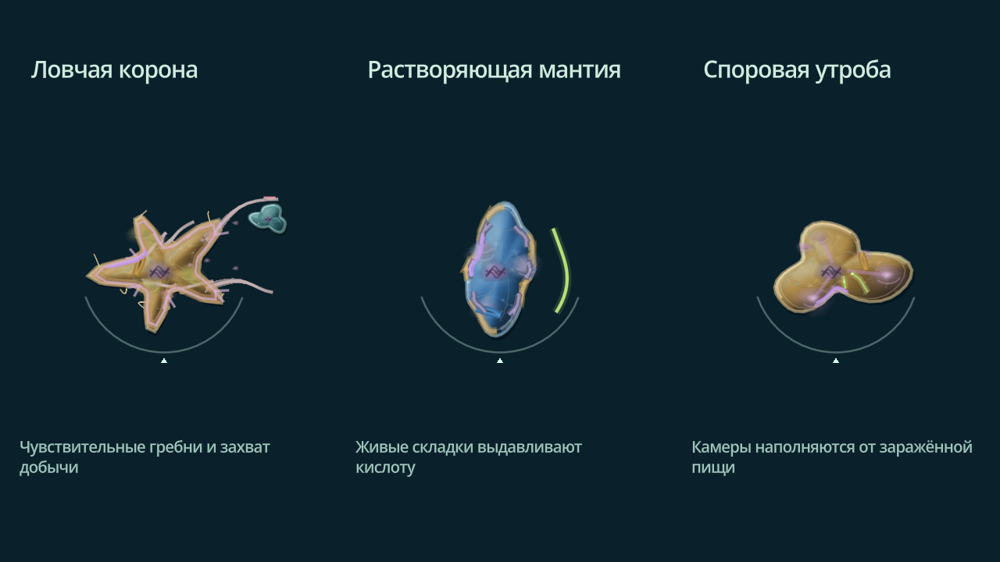

> Три поведенческие эволюции включены в основу 1.0. Ниже сохранены технические решения этапа разработки.

# Живые эволюции — рабочая реализация

Статус: в отдельной ветке, без релиза и смены версии приложения. Основа — 0.11.0 (`c56774a`). Дорожная карта: [ROADMAP.md](../../ROADMAP.md).

## Что реализовано

- **Ловчая корона** (щупальца 6 + рецепторы 3 + эволюционная награда): максимум две меньшие или сильно повреждённые цели. Часть отростков окружает добычу и плавно направляет её к горлу пасти, вычисленному по действующему контуру. Остальные отростки продолжают обычные удары по другим целям. Удержание прекращается при выходе из радиуса, потере допустимости по размеру/здоровью или замене органа. Боссы не удерживаются. Визуально — толстый живой воротник, чувствительные гребни, охватывающие отростки. При наличии кислоты удерживающая ткань наносит отдельный ограниченный тканевой стойкостью кислотный урон; заражающие окончания поддерживают инфекцию на удерживаемой цели.
- **Растворяющая мантия** (кислота 6 + мембрана 3 + награда): столкновение выдавливает кислоту из соответствующего участка реальной границы тела. Пятно живёт 1,2 с, радиус 0,8 радиуса тела, повтор не чаще чем раз в 2 с. Урон проходит через прежнюю тканевую стойкость и учитывается как кислотный. Выстрелы и ядовитые поля не вызывают контактный ответ. Мантия не отменяет полученный урон. Складки мембраны сокращаются в момент выделения кислоты.
- **Споровая утроба** (заражение 6 + усвоение 3 + награда): полностью переваренная заражённая порция даёт один заряд. При третьей порции камеры выпускают облако спор на 2,4 с радиусом 2,3 радиуса тела. Контакт, захват и повторные обновления одного фрагмента не начисляют дополнительные заряды. Заряд 0–2 сохраняется между запусками; старое сохранение начинает с нуля. На теле видны три пульсирующие камеры и соединяющие их сосуды, в меню — текущее заполнение.

Прежние ID рецептов, требования, качество и бонус урона ×1,30 сохранены. Остальные три эволюции пока имеют прежний числовой эффект. В инспекторе показаны дополнительное поведение, длительности, радиусы и расчётный урон до сопротивления ткани.

После получения эволюции ткань разрастается примерно за 2,2 с. Форма мембраны, её повреждения, физический контакт и расположение органов используют одну геометрию. Восстановленный из сохранения организм показывается уже сформированным.

## Проверка

```sh
# Полная проверка; для native нужен работающий DISPLAY или xvfb-run:
python3 ci/run_tests.py
# Десять минут симуляции с тремя эволюциями и восстановлением JSON-чекпоинтов:
godot --headless --path . --script tests/stress_evolutions.gd
```

Регрессии проверяют допустимость удержания и его предел, отсутствие мгновенного перемещения, наведение на реальную узкую пасть, обычные удары рядом с удерживаемой добычей, обновление геометрии при приобретении/утрате эволюции и с течением времени, контактный ответ мантии/перезарядку, заряд только после переваривания и сохранение через JSON. Native-проверка рисует три анатомии в 30 фазах; для 12 геномов и трёх уровней повреждений проверяется безопасная геометрия одиночных и смешанных эволюций.

Десятиминутный стресс-прогон: ошибок 0; максимум 2 удерживаемые цели, 16 врагов, 19 полей, 96 останков, 42 эффекта. На контрольных точках память: 22,72 → 23,57 → 24,11 → 24,12 → 24,13 МБ. Это наблюдение ограниченного состояния в одном сценарии, не гарантия отсутствия утечек и не измерение Android FPS. Результаты и журнал находятся в `build/evolution-stress.json` и `build/evo-stress.log`.

Свежая проверка кода выявила и помогла исправить три ошибки: перенаправление всех атак на удерживаемые цели, фиксированную точку пасти вне узкого контура и устаревающий кэш физической формы. Исправления закреплены регрессионными тестами.

## Предпросмотр



Это снимок реальной процедурной отрисовки тестовой сцены. Плавность на физическом Android ещё не проверена. Видео и APK не выпускались.
